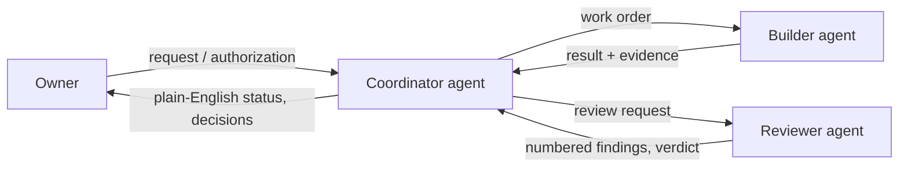

# Agent Dispatch Dashboard (ADD)

ADD is a system I built to coordinate several AI agents as an accountable team: a coordinator that plans and routes work, builders that write code, independent reviewers that check it, and the project owners who authorize anything owner-level. It is used regularly in a private environment for real work.

This repository is a public overview. The working system and its records stay private because they coordinate real business work.

## Why I built it
I wanted a durable record, clear ownership and independent checks around AI-assisted work, without losing the speed of AI agents.

## How it works

- **Structured messages.** Messages record sender, recipient, conversation and linked artifacts. The runner routes messages to registered people and agents and launches supported workers. Worker replies include a structured result and the next actor.
- **Registered roles.** People and agents have registered identities and roles (coordinator, builder, reviewer, owner), used for routing. Authority comes from the owners' authorization, not from what another agent says.
- **Independent review.** Substantive changes go through independent review. Reviewers return numbered findings, marking which ones block progress. Review packets identify exact artifact versions, and distinguish verified results from incomplete work.
- **Bounded work units.** Units of work carry an explicit scope, budget and deadline. Overruns and departures are reported.
- **Owner authorization.** Owner-level actions require the relevant owner's authorization. A "Needs you" view separates real decisions from status updates, and updates are written to be read on a phone.
- **Releases.** The release process calls for testing, independent review, browser acceptance and a recovery plan. Performance and release safeguards are still being improved.
- **Scoped work.** Work is scoped to approved files and actions. Production access, credentials, spending and public publication require specific authorization.

## Where it stands
- Used across hundreds of recorded conversations for software work, research and documentation.
- Combines Claude and OpenAI agents as coordinators, builders and independent reviewers.
- Project-specific coordination and a dedicated reviewer are being developed.

Built by Aaron.
